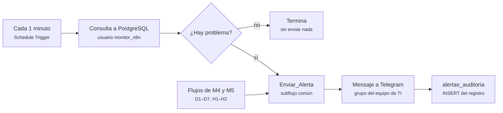
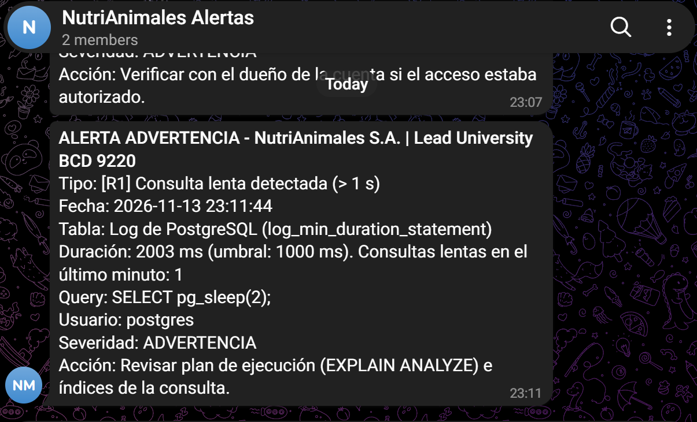
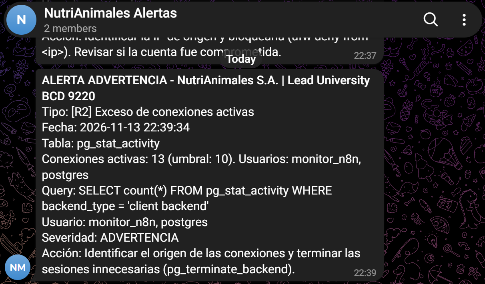
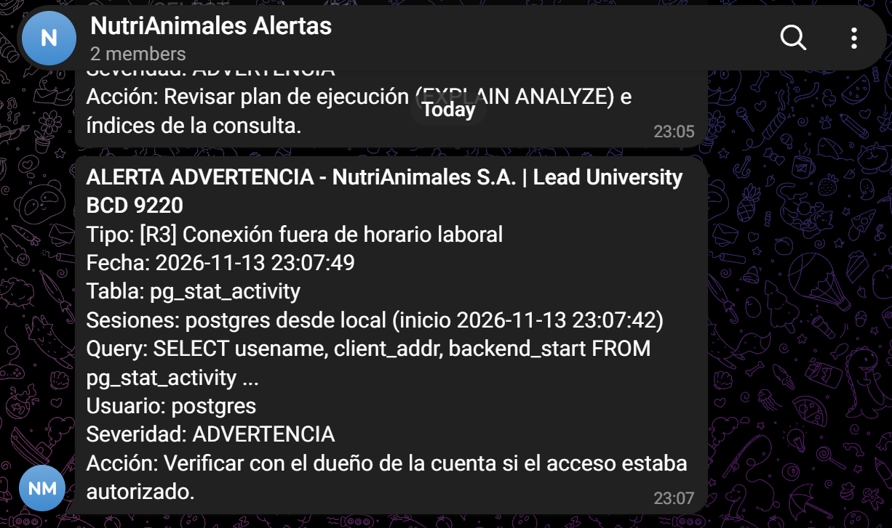
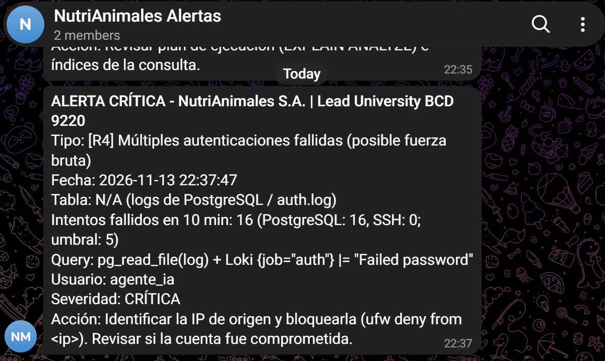
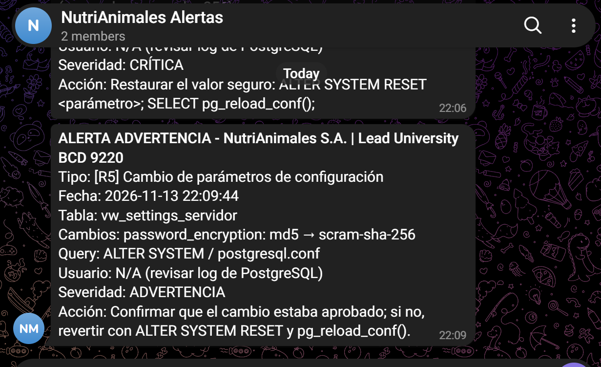
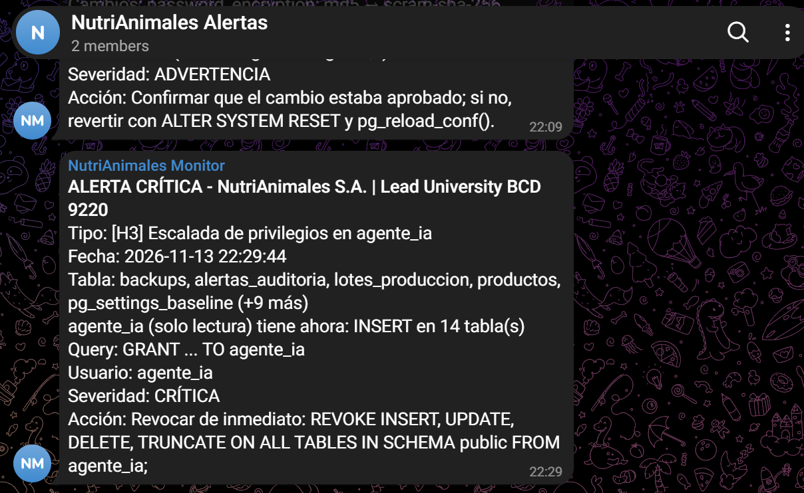
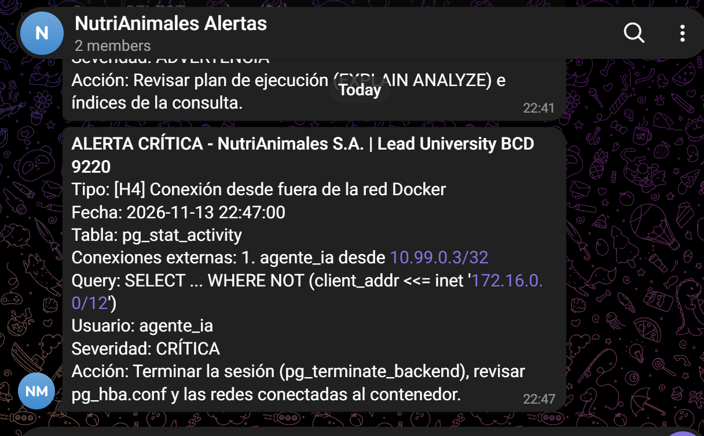
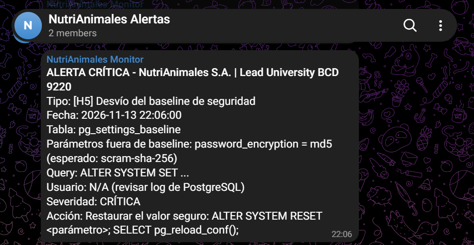
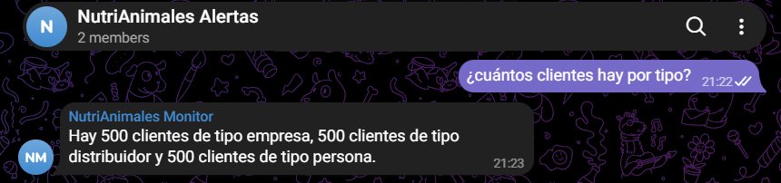

# Informe M3 — N8N, bot de Telegram y alertas R1–R5 / H3–H5

**Proyecto NutriAnimales S.A. · BCD 9220 · Responsable: Luis Rojas (M3) · 13 de noviembre de 2026**

## Introducción

N8N es la capa de monitoreo del sistema. Cada minuto consulta PostgreSQL, decide si hay un problema y avisa al equipo de TI por Telegram en menos de 60 segundos. Además ofrece un bot que responde preguntas sobre los datos en lenguaje natural.

Esta sección cubre la parte de M3: la arquitectura de N8N, las cinco alertas de rendimiento (R1–R5), tres alertas de hardening (H3–H5) y el bot conversacional con Groq. Las alertas H1–H2 y D1–D7 y los ataques A1–A5 están en las secciones de M4 y M5, y todas usan el mismo mecanismo de envío descrito aquí.

Todas las pruebas se hicieron el 13 de noviembre de 2026 sobre el stack del repositorio (`docker compose up -d`), con N8N 2.45.5, Telegram y Groq reales. Las capturas están en `docs/capturas/`.

## Arquitectura de N8N

Cada alerta es un flujo independiente con el mismo patrón de cuatro pasos, y todas terminan en un único subflujo, `Enviar_Alerta`. Así el formato del mensaje y el registro en la base de datos están definidos en un solo lugar para las 17 alertas del proyecto (R1–R5, H1–H5 y D1–D7).

El paso "¿Hay problema?" es un nodo de código que compara el resultado contra el umbral. Si no hay problema, el flujo termina sin enviar nada. Si lo hay, arma un mensaje con el contrato del grupo: código, severidad, tipo, tabla, detalle, consulta, usuario y acción recomendada.

`Enviar_Alerta` agrega la fecha y hora de Costa Rica, envía el mensaje con el formato oficial al grupo de Telegram y lo guarda en `alertas_auditoria`. Ahí la columna `alerta` lleva el código (R1, H3…) y `tipo` la categoría (rendimiento, hardening o datos).

N8N usa cuatro credenciales, creadas por `scripts/init_n8n_m3.sh` a partir del `.env`. Ninguna contraseña ni llave queda escrita dentro de los flujos.

| Credencial | Para qué se usa | Permisos |
| --- | --- | --- |
| Postgres `monitor_n8n` | Consultas de las alertas e `INSERT` de los registros | Lectura de estadísticas y logs; escritura solo en tablas de auditoría |
| Postgres `agente_ia` | Consultas del bot | Solo lectura |
| Telegram | Envío de alertas y respuestas del bot | Token del bot |
| Groq | Generar SQL y redactar respuestas | Lee `GROQ_API_KEY` del `.env` en cada uso |

## Alertas de rendimiento R1–R5

Las cinco alertas de rendimiento se dispararon en las pruebas y llegaron al grupo de Telegram en menos de un minuto. Cada una se revisa cada minuto con el usuario `monitor_n8n`.

| Código | Qué detecta | Fuente y umbral | Severidad | Cómo se emuló | Resultado |
| --- | --- | --- | --- | --- | --- |
| R1 | Consulta lenta | Log de PostgreSQL (`log_min_duration_statement` = 1000 ms) | Advertencia | `SELECT pg_sleep(2);` | Alerta con la duración, la consulta y el usuario |
| R2 | Exceso de conexiones | `pg_stat_activity`, > 10 sesiones de cliente | Advertencia | 12 sesiones con `pg_sleep(120)` | "Conexiones activas: 13 (umbral: 10)" |
| R3 | Conexión fuera de horario | `pg_stat_activity`, entre 23:00 y 06:00 | Advertencia | Sesión abierta después de las 23:00 | Alerta con usuario y hora de inicio |
| R4 | Autenticaciones fallidas | Log de PostgreSQL + `auth.log` vía Loki, > 5 en 10 min | Crítica | 8 conexiones con contraseña incorrecta | "Intentos fallidos en 10 min: 16 (umbral: 5)" |
| R5 | Cambio de parámetros | `vw_settings_servidor` contra `pg_settings_snapshot` | Advertencia | `ALTER SYSTEM` sobre `password_encryption` | "password_encryption: md5 → scram-sha-256" |

Los scripts de emulación, detección y limpieza están en `sql/pruebas/R1.sql` a `R5.sql`.

Detalles de implementación:

- **R1 lee el log de PostgreSQL.** Con el baseline de M2, PostgreSQL anota cada sentencia de más de 1 segundo con su hora exacta. El flujo revisa solo las del último minuto, así una consulta lenta de ayer no vuelve a alertar.
- **R4 combina dos fuentes.** Lee el log de PostgreSQL con `pg_read_file` y, si Loki está disponible, suma los intentos fallidos de SSH del ataque A1. Si Loki no responde, la alerta sigue funcionando solo con PostgreSQL. Los 8 intentos aparecen como 16 porque `psql` reintenta cada conexión sin SSL después del primer rechazo.
- **R5 avisa una sola vez por cambio.** Después de comparar, el flujo actualiza la foto de parámetros, así el mismo cambio no se vuelve a reportar.

| | |
| --- | --- |
|  |  |
|  |  |
|  | |

## Alertas de hardening H3–H5

Las tres alertas de hardening se dispararon con severidad crítica, porque cada una indica que una medida de seguridad dejó de cumplirse.

| Código | Qué detecta | Consulta de detección | Cómo se emuló | Respuesta |
| --- | --- | --- | --- | --- |
| H3 | El usuario de solo lectura `agente_ia` recibió permisos de escritura (también detecta el ataque A4) | `has_table_privilege('agente_ia', tabla, 'INSERT/UPDATE/DELETE/TRUNCATE')` | `GRANT INSERT ON ALL TABLES IN SCHEMA public TO agente_ia;` | `REVOKE` de esos permisos |
| H4 | Conexión desde fuera de la red Docker | `client_addr` fuera de `172.16.0.0/12` en `pg_stat_activity` | Contenedor cliente en una red `10.99.0.0/24` conectada a PostgreSQL | Terminar la sesión y revisar `pg_hba.conf` |
| H5 | Parámetro distinto al baseline de seguridad | `pg_settings` contra `pg_settings_baseline` | `ALTER SYSTEM SET password_encryption = 'md5';` | Volver a `scram-sha-256` y recargar |

Resultados: H3 reportó "INSERT en 14 tablas", H4 reportó "agente_ia desde 10.99.0.3" y H5 reportó "password_encryption = md5 (esperado: scram-sha-256)". El cambio de H5 también dispara R5, así que un solo comando muestra dos alertas en la demo.

Los scripts de prueba están en `sql/pruebas/H3.sql`, `H4.sql` y `H5.sql`.

| | |
| --- | --- |
|  |  |
|  | |

## Bot conversacional con Groq

El bot responde en Telegram preguntas sobre los datos de NutriAnimales. En la prueba, a la pregunta "¿cuántos clientes hay por tipo?" respondió en unos 20 segundos: "Hay 500 clientes de tipo empresa, 500 clientes de tipo distribuidor y 500 clientes de tipo persona".

Cómo funciona:

1. Cada 10 segundos N8N pregunta a Telegram si hay mensajes nuevos (`getUpdates`). Solo atiende el grupo autorizado (`TELEGRAM_CHAT_ID`); los mensajes de otros chats se ignoran.
2. El filtro anti-SQLi de M5 revisa el texto. Si encuentra `;`, `--`, `/*` o palabras como `DROP` o `DELETE`, responde "Consulta rechazada por política de seguridad" y registra el intento en `auditoria_datos`.
3. Si el texto pasa, N8N lee las tablas y columnas reales de la base y se las envía a Groq (modelo `openai/gpt-oss-120b`) junto con la pregunta. Groq devuelve una consulta SQL.
4. N8N valida esa consulta, la ejecuta con el usuario `agente_ia` y le pide a Groq que redacte la respuesta en español a partir de los resultados.
5. El bot envía la respuesta al grupo.

El bot tiene **tres barreras de seguridad**, de modo que si una falla, las otras siguen protegiendo:

| Barrera | Qué hace | Qué bloquea |
| --- | --- | --- |
| Filtro de entrada (M5) | Revisa el mensaje antes de llamar a Groq | Inyección SQL escrita por el usuario (ataque A2) |
| Validación del SQL generado | Acepta una sola sentencia `SELECT` o `WITH`, sin palabras peligrosas, y limita el resultado a 50 filas | SQL peligroso que la IA pudiera generar por error o manipulación |
| Usuario `agente_ia` | Solo tiene permiso de lectura en la base | Cualquier escritura, aunque las dos barreras anteriores fallen |

La prueba del ataque A2 (`Lista datos; DROP TABLE clientes; --`) y su captura las presenta M5.

## Decisiones de diseño y problemas resueltos

| Decisión o problema | Qué se hizo | Por qué |
| --- | --- | --- |
| Bot por sondeo en vez de webhook | `getUpdates` cada 10 segundos | Telegram no acepta el certificado autofirmado de Nginx y el servidor no es público |
| El bot no recibía las preguntas del grupo | Se desactivó el modo privacidad del bot en BotFather y se volvió a agregar al grupo | Con el modo privacidad activo, Telegram solo entrega al bot los comandos que empiezan con `/` |
| Telegram rechazaba algunas alertas ("Bad request") | Los mensajes se envían en formato HTML, con `<`, `>` y `&` escapados | El nodo de Telegram usa Markdown por defecto, y un `_` suelto (como en `password_encryption`) rompe el mensaje |
| Alertas repetidas cada minuto | Antes de enviar, `Enviar_Alerta` revisa en `alertas_auditoria` si la misma alerta (mismo código y detalle) ya salió en los últimos 10 minutos | Evitar llenar el grupo de mensajes mientras un problema sigue activo. Se guarda en la base porque en N8N 2.x la memoria interna de un flujo publicado no se conserva entre ejecuciones |
| Ningún secreto dentro de los flujos | Credenciales de N8N creadas por `scripts/init_n8n_m3.sh` desde el `.env`; la de Groq lee `GROQ_API_KEY` en cada uso | Rotar la llave de Groq solo requiere editar el `.env` y reiniciar N8N |
| Modelo de Groq retirado | Se cambió `llama-3.3-70b-versatile` por `openai/gpt-oss-120b` | Groq apagó el modelo anterior el 16 de agosto de 2026 |
| Subflujo inactivo en N8N 2.x | El script activa `Enviar_Alerta` y reinicia N8N | En N8N 2.x un subflujo debe estar publicado para que otros flujos lo llamen |
| Reimportar flujos activos falla | El script desactiva los flujos antes de importarlos | N8N 2.45 no deja sobrescribir un flujo activo |
