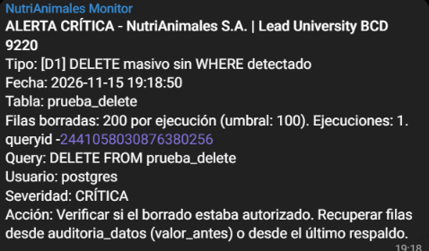
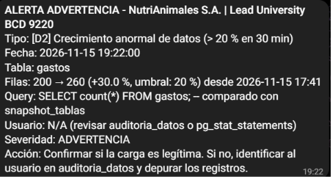
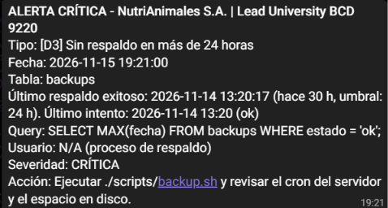
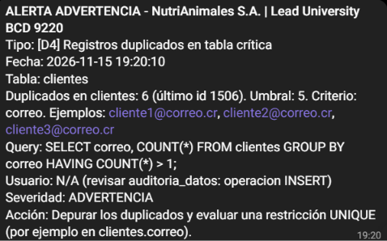
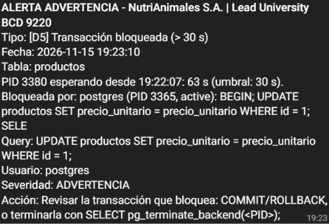
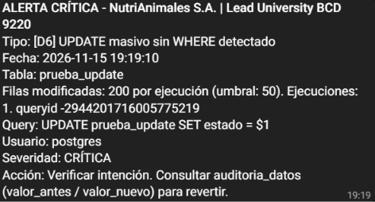
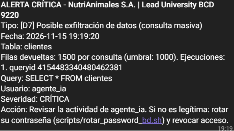

# Informe M4 — Alertas de seguridad de datos D1–D7

**Proyecto NutriAnimales S.A. · BCD 9220 · Responsable: Jorge Chaves (M4) · 14 de noviembre de 2026**

## Introducción

Las alertas de rendimiento y de hardening vigilan al servidor. Las alertas de datos vigilan **lo que se hace con la información**: borrados y actualizaciones masivas, cargas anormales, respaldos que no se hicieron, registros duplicados, bloqueos y extracción masiva de datos sensibles.

Las siete alertas usan la arquitectura de la sección de M3. Cada minuto un flujo de N8N consulta PostgreSQL con el usuario `monitor_n8n`. Si hay un problema, arma el mensaje con el contrato del grupo y llama al subflujo `Enviar_Alerta`, que lo envía al grupo de Telegram y lo guarda en `alertas_auditoria`.

## Resumen de las alertas

| Código | Qué detecta | Fuente | Umbral | Severidad | Respuesta recomendada |
| --- | --- | --- | --- | --- | --- |
| D1 | `DELETE` masivo sin `WHERE` | `pg_stat_statements` | > 100 filas por ejecución | Crítica | Recuperar desde `auditoria_datos` o el último respaldo |
| D2 | Crecimiento anormal de una tabla | `snapshot_tablas` + `count(*)` | > 20 % en 30 min | Advertencia | Revisar el origen de la carga en `auditoria_datos` |
| D3 | Sin respaldo exitoso | Tabla `backups` | > 24 h | Crítica | Ejecutar `backup.sh` y revisar el cron |
| D4 | Registros duplicados | `clientes` (correo) y `ventas` | > 5 | Advertencia | Depurar y evaluar una restricción `UNIQUE` |
| D5 | Transacción bloqueada | `pg_stat_activity` + `pg_blocking_pids` | > 30 s | Advertencia | `COMMIT`/`ROLLBACK` o `pg_terminate_backend` |
| D6 | `UPDATE` masivo sin `WHERE` | `pg_stat_statements` | > 50 filas por ejecución | Crítica | Revertir con `valor_antes` de `auditoria_datos` |
| D7 | Posible exfiltración | `pg_stat_statements` | > 1,000 filas por consulta en `clientes` o `ventas` | Crítica | Rotar la contraseña del usuario y revocar acceso |

Los escenarios de emulación, detección y limpieza están en `sql/pruebas/D1.sql` a `D7.sql`, y `scripts/demo_m4.sh` los ejecuta uno por uno.

## Problema principal: una alerta por evento

El plan pedía que cada alerta se dispare **una sola vez por evento**. Las consultas del enunciado no lo logran, porque su condición sigue siendo verdadera después del evento:

- **`pg_stat_statements` acumula.** Guarda una fila por consulta normalizada y suma las filas de todas sus ejecuciones. Después de un `DELETE` de 200 filas, la condición de D1 queda verdadera hasta que alguien reinicie las estadísticas, y la alerta saldría cada minuto.
- **Algunas condiciones duran.** Un respaldo atrasado, unos duplicados o un crecimiento siguen ahí en el minuto siguiente.

`Enviar_Alerta` descarta la misma alerta durante 10 minutos, pero después la volvería a enviar. Por eso cada alerta de datos recuerda qué ya avisó:

| Alertas | Mecanismo |
| --- | --- |
| D1, D6, D7 | Se usa `rows / calls` (filas promedio por ejecución) y, en la misma consulta, `pg_stat_statements_reset(userid, dbid, queryid)` borra solo la entrada detectada. Si la consulta se vuelve a ejecutar, es un evento nuevo |
| D2 | La consulta guarda una foto por minuto en `snapshot_tablas` y compara contra la foto más reciente de hace al menos 30 minutos. Cuando una tabla alerta, se borran sus fotos anteriores y su ventana empieza de nuevo |
| D3, D4, D5 | La consulta arma una **marca** del evento: la fecha del último respaldo (D3), el id más alto de los duplicados (D4) o el PID y la hora de inicio del bloqueo (D5). Si ya hay una alerta con esa marca en `alertas_auditoria`, no devuelve nada |

En D2, la foto, la comparación y la limpieza van en **una sola sentencia** con CTE que modifican datos (`WITH … INSERT … DELETE … SELECT`). Así no puede quedar una foto guardada sin su comparación si N8N falla a mitad del flujo.

## Detalle por alerta

**D1 y D6 — `DELETE` y `UPDATE` sin `WHERE`.** La consulta busca en `pg_stat_statements` sentencias que empiezan con `DELETE` o `UPDATE`, no contienen `WHERE` y afectan en promedio más de 100 (D1) o 50 (D6) filas por ejecución. Se usan expresiones regulares con límites de palabra (`\m`, `\M`) en vez de `ILIKE`, que confundiría una columna llamada `somewhere` con un `WHERE`.

El flujo R5 de M3 hace `DELETE FROM pg_settings_snapshot;` sin `WHERE` cada minuto, sobre unas 380 filas. Por eso D1 y D6 ignoran las dos tablas auxiliares del monitoreo; si no, D1 saltaría cada minuto.

**D2 — Crecimiento anormal.** Se cuentan las filas de las 8 tablas de negocio con `count(*)`. No se usa `n_live_tup`, que es una estimación que cambia cuando corre autovacuum o `ANALYZE` y puede producir alertas falsas. Se exige además una diferencia de al menos 10 filas, porque en `plantas` (3 filas) un solo registro nuevo ya es un 33 %.

**D3 — Sin respaldo.** Lee el último respaldo con estado `ok` de la tabla `backups`, que llena `scripts/backup.sh` de M2. El mensaje incluye también el último intento y su estado, para distinguir "no se ejecutó" de "se ejecutó y falló".

**D4 — Duplicados.** En `clientes` el criterio es el correo, que M2 dejó sin `UNIQUE` a propósito. En `ventas`, el mismo cliente, producto, cantidad y fecha exacta. El mensaje incluye tres ejemplos.

**D5 — Bloqueos.** Busca sesiones con `wait_event_type = 'Lock'` que llevan más de 30 segundos esperando. Con `pg_blocking_pids` identifica qué sesión las bloquea y qué está ejecutando, y con `pg_locks` la tabla afectada. `monitor_n8n` puede ver las consultas de otros usuarios porque tiene el rol `pg_monitor`.

**D7 — Exfiltración.** Es la consulta del enunciado corregida (Plan, sección 10, punto 1). El filtro de tablas va entre paréntesis, para que el umbral aplique a `clientes` y a `ventas`. El usuario sale de `pg_roles.rolname`, porque `pg_roles` no tiene la columna `usename`.

D7 es también la detección del ataque A5 de M5 (`SELECT * FROM clientes` como `agente_ia`), así que **no** excluye a `agente_ia`. Los falsos positivos se evitan de otra forma:

- El bot nunca devuelve más de 50 filas, porque M3 fuerza `LIMIT 50`.
- El gerente solo consulta vistas, y `vw_ventas_resumen` no coincide con la palabra `ventas`.
- Los respaldos usan `COPY`, no `SELECT`.
- Solo se excluye a `monitor_n8n`.

## Pruebas y resultados

Las consultas de los siete flujos se probaron el 14 de noviembre de 2026 contra una base creada con los scripts `sql/00`–`06` del repositorio, conectado como `monitor_n8n`. Se probó lo que dispara cada alerta, que no se repita en el ciclo siguiente y que no haya falsos positivos.

| Código | Emulación | Resultado | Ciclo siguiente |
| --- | --- | --- | --- |
| D1 | `DELETE FROM prueba_delete;` (copia de 200 ventas) | Alerta: 200 filas, usuario `postgres` | Sin alerta. El `DELETE` de R5 nunca apareció |
| D2 | 60 filas nuevas en `gastos` | "Filas: 200 → 260 (+30 %)" | Sin alerta |
| D3 | `UPDATE backups SET fecha = NOW() - INTERVAL '30 hours';` | Alerta: último respaldo hace 30 h | Sin alerta. Tras un respaldo nuevo, la condición desaparece |
| D4 | 6 clientes con correo repetido | "Duplicados en clientes: 6" | Sin alerta. Con 2 duplicados más salió una alerta nueva (8) |
| D5 | Dos sesiones con `UPDATE` sobre el mismo producto | A los 34 s: sesión bloqueada, bloqueador y tabla `productos` | — |
| D6 | `UPDATE prueba_update SET estado = 'cancelado';` (200 filas) | Alerta: 200 filas | Sin alerta. Un `UPDATE` de 1 fila en `backups` no alertó |
| D7 | `SELECT * FROM clientes;` como `agente_ia` | Alerta: 1,508 filas, usuario `agente_ia` | Sin alerta. `SELECT … LIMIT 50` y `vw_ventas_resumen` no alertaron |

_Capturas de Telegram (se toman en el servidor de la demo con `./scripts/demo_m4.sh D<n>`):_

| | |
| --- | --- |
|  |  |
|  |  |
|  |  |
|  | |

## Limitaciones conocidas

- **Promedios en `pg_stat_statements`.** D1, D6 y D7 usan filas promedio por ejecución. Si una misma consulta normalizada se ejecuta muchas veces con pocas filas antes de una ejecución masiva, el promedio puede quedar bajo el umbral. El reset tras cada alerta reduce este caso.
- **Exfiltración por otras vías.** D7 solo mira `SELECT`. Un `COPY … TO` o muchas consultas pequeñas seguidas no se detectan.
- **Reset antes del envío.** En D1, D6 y D7 la entrada se reinicia en la misma consulta que la detecta. Si Telegram falla justo en ese momento, la alerta no se reintenta. La ejecución fallida queda en el historial de N8N.
- **Exclusiones por nombre.** D1 y D6 ignoran las dos tablas auxiliares del monitoreo, y D7 ignora a `monitor_n8n`. Una acción maliciosa sobre esas tablas o con ese usuario no dispararía D1, D6 ni D7. Las tablas de negocio siguen cubiertas.
